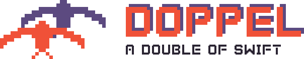

# Doppel

<picture><source media="(prefers-color-scheme: dark)" srcset="assets/banner-dark.png"></picture>

A doppelgänger of Swift: Doppel checks Swift code the way the compiler would and runs one actor from it live, without
compiling, with every other actor handled by the host app.

It's built for code written at runtime, such as code a language model writes, and run where
`swiftc` can't be: on a device, in a sandbox, inside an app. The code is plain Swift. Doppel
doesn't define a language of its own; it's a double of Swift, held to what the compiler says.

## What it does

**`Doppel`: the checker.** It reads a set of Swift files as one module and resolves every name
and type the way `swiftc` does:
- structs, enums, actors, protocols (nested ones too), extensions, closures, optionals,
  collections, and some generics;
- types, conformance, `async`/`await`, `throws`/`try`, initializers and mutability, each problem
  reported in the compiler's words, at its line;
- a standard library and a subset of Foundation, written in the same Swift it checks.

It also says what each type declares (`Declarations`): fields, methods, enum cases, protocols with
their requirements, and conformances, for a host to describe or check code against.

**`DoppelRuntime`** runs one actor from the checked code. You send it messages, and it handles
them one at a time, as a Swift actor does. Anything outside it (other actors, host functions,
tasks) is passed to your app through `ActorHost`.

**`DoppelCompilerCheck`: held to `swiftc`.** It runs the real compiler on the same files. The
tests use it to keep the checker agreeing with Swift across a corpus of real code.

## What it isn't

It isn't a general Swift interpreter. Its unit is one checked actor in a module the host
supplies; the rest of Swift is there as far as that needs it. Where Doppel and `swiftc` disagree,
`swiftc` is right.

## Requirements

Swift 6.4, macOS 15 or iOS 18.

## Origins

Doppel began as a fork of [SwiftScript](https://github.com/Cocoanetics/SwiftScript) by Oliver
Drobnik, a Swift interpreter written in Swift. It has since been rewritten as a checker and an
actor runtime, and none of SwiftScript's source remains, but the idea and the start are his.
Both are under the MIT License; see [LICENSE](LICENSE). The swift in `assets/` is drawn for Doppel; the banners'
letters are from [Kenney](https://www.kenney.nl)'s [1-Bit Pack](https://kenney.nl/assets/1-bit-pack) (CC0).
